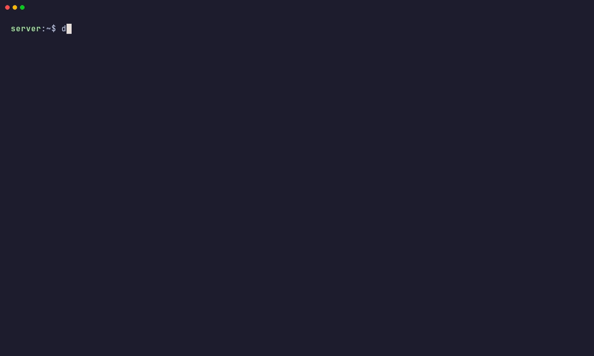
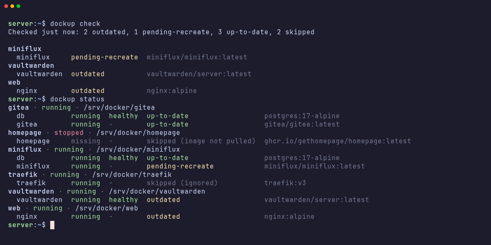
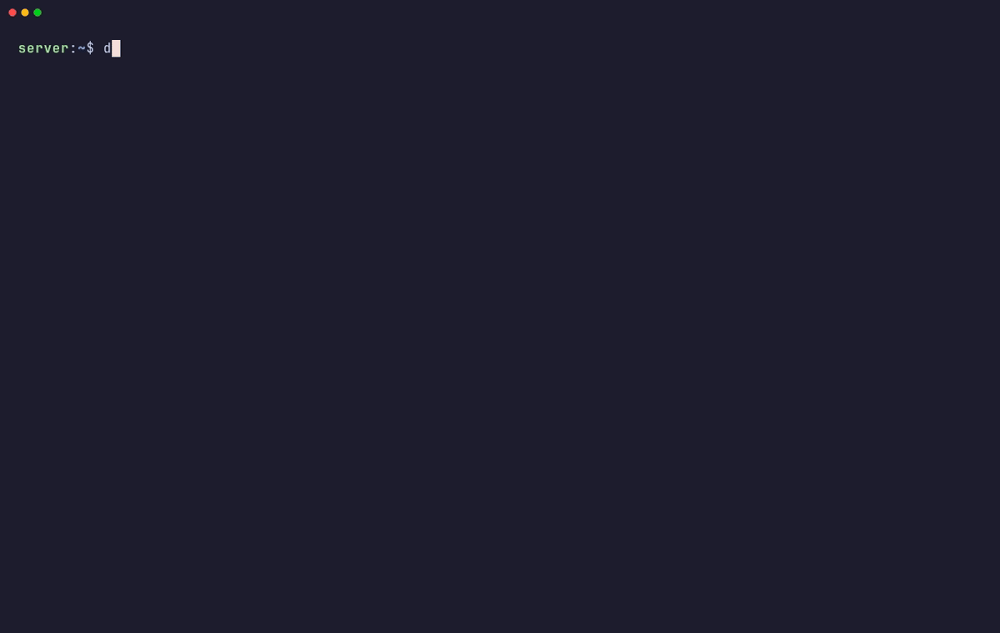
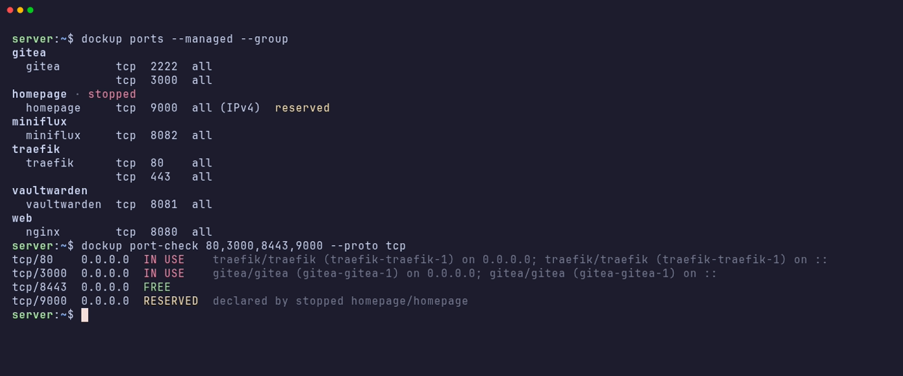

# dockup

A terminal dashboard for a server full of `docker compose` projects
(`/srv/docker/<project>` by default): their state, image updates and ports.



## Features

- **Status**: every compose project with its containers, health and update
  state. Stopped projects are included.
- **Update check**: compares your local images with the registry by digest,
  without pulling. `outdated` means a newer image exists. `pending-recreate`
  means it's already pulled but the container still runs the old one.

  

- **Updates**: pull and recreate a whole project or a single service, from the
  CLI or the UI.

  

- **Ports**: which container or process owns each listening port, and whether a
  port is free before you use it. Ports declared by stopped projects show as
  reserved.

  

## Install

**Alpine Linux**

```
sudo wget -O /etc/apk/keys/dockup.rsa.pub https://filiprojek.github.io/dockup/alpine/dockup.rsa.pub
echo https://filiprojek.github.io/dockup/alpine | sudo tee -a /etc/apk/repositories
sudo apk update && sudo apk add dockup
```

**Void Linux**

```
echo repository=https://filiprojek.github.io/dockup/void | sudo tee /etc/xbps.d/dockup.conf
sudo xbps-install -S dockup
```

Accept the key only if its fingerprint is
`04:a0:0a:e2:a3:01:bc:2c:44:a7:43:f7:47:c2:aa:9e`.

Packages are available for x86_64 and aarch64 (on Void, for glibc and musl).
They update with the rest of your system and don't pull in docker.

**Other Linux**: download a binary from
[Releases](https://github.com/filiprojek/dockup/releases):

```
VER=1.0.1 ARCH=amd64   # or arm64
curl -L https://github.com/filiprojek/dockup/releases/download/v$VER/dockup_${VER}_linux_$ARCH.tar.gz | tar xz dockup
sudo install -m 0755 dockup /usr/local/bin/
```

**Docker**: `ghcr.io/filiprojek/dockup`, see
[docker-compose.example.yml](docker-compose.example.yml).

## Usage

```
dockup                      # compact dashboard
dockup ui                   # interactive UI (also: dockup -i)
dockup status               # projects → services: state, health, updates
dockup check                # query registries for newer images
dockup update immich        # pull + recreate a project
dockup update immich/redis  # ...or a single service
dockup update --all -n      # dry run for everything that's outdated
dockup ports --managed --group
dockup port-check 8080,9000-9010
dockup port-check --free 8000-9000
```

Every command supports `--json`, `--config` and `--root`. Run as a user in the
`docker` group. Use `sudo` to see the names of processes owned by other users.

## Configuration

Copy [config.example.yml](config.example.yml) to `~/.config/dockup/config.yml`
or `/etc/dockup/config.yml`. To exclude a service from update checks, add the
label `dockup.ignore: "true"` to it.

For periodic checks with notifications (ntfy, gotify or a webhook), use cron or a
systemd timer:

```
0 */6 * * *  dockup check --notify >/dev/null
```

Updates are logged to `~/.local/state/dockup/dockup.log`.

## Development

```
make build   # ./dockup
make test
make lint
make demo    # re-record the README images (isolated Docker-in-Docker)
```

Architecture, conventions and the release process are in [AGENTS.md](AGENTS.md).

## License

[AGPL-3.0-or-later](LICENSE) © 2026 Filip Rojek
